# OpenSpot

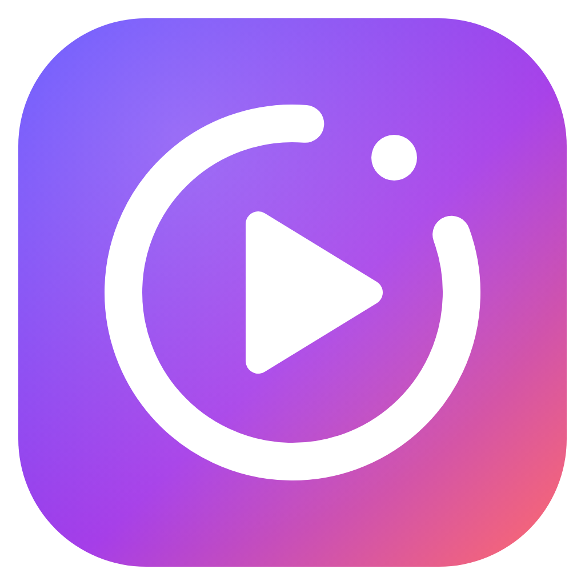

A Spotify-style music player for **Windows**, **macOS** and **Android** that plays **YouTube Music**, **Plex** and your own music files in one app. It is built on a Rust + Tauri 2 core and a React UI (`apps/openspot`).

**Download:** [latest release](https://github.com/knivesbatz/OpenMusic/releases/latest). It has:

- the Windows installer (`OpenSpot_<version>_x64-setup.exe`);
- the Mac disk image (`OpenSpot_<version>_universal.dmg`, for Apple silicon and Intel Macs, macOS 11 or later);
- the Android APK (`OpenSpot_<version>_android-arm64.apk`).

The Windows and Mac apps check for a new version when they start and update themselves. The Android app tells you when there's a new one.

**Installing on a Mac:** open the `.dmg` and drag OpenSpot into Applications. The app isn't notarized by Apple (that needs a paid developer account), so the first time, macOS says it can't check the app. Open **System Settings → Privacy & Security**, scroll down, click **Open Anyway** next to OpenSpot, then confirm. After that it opens normally.

## Services and sign-in

OpenSpot plays music from one or more **services**. Each has its own card in **Settings → Services**, with an on/off switch, the account it's signed in to, and Sign in / Sign out.

- **YouTube Music:** sign in with your Google account. You can also turn it on without an account, to browse and play anonymously. YouTube Music Premium is not required.
- **Plex:** sign in with your Plex account and pick a Plex Media Server that has a music library. The card also lets you change the server and switch Plex Home user.
- **Local files** always work. You can add music folders even with both services off.

On first start, OpenSpot shows **Connect your music**, where you can pick YouTube Music, Plex, YouTube Music without an account, or local files only.

Switching a service off keeps you signed in, but hides that service everywhere: Home, Search, Your Library, Browse and Liked Songs. Its songs in your playlists and history are greyed out and skipped. Switch it back on and everything returns.

With both services on:

- **Search** shows one combined list. Each row has a small badge for the service it came from.
- **Home** shows your Plex shelves first, then YouTube Music's recommendations.
- **Liked Songs** combines your YouTube likes and your rated Plex tracks.

## Screenshots

### Windows

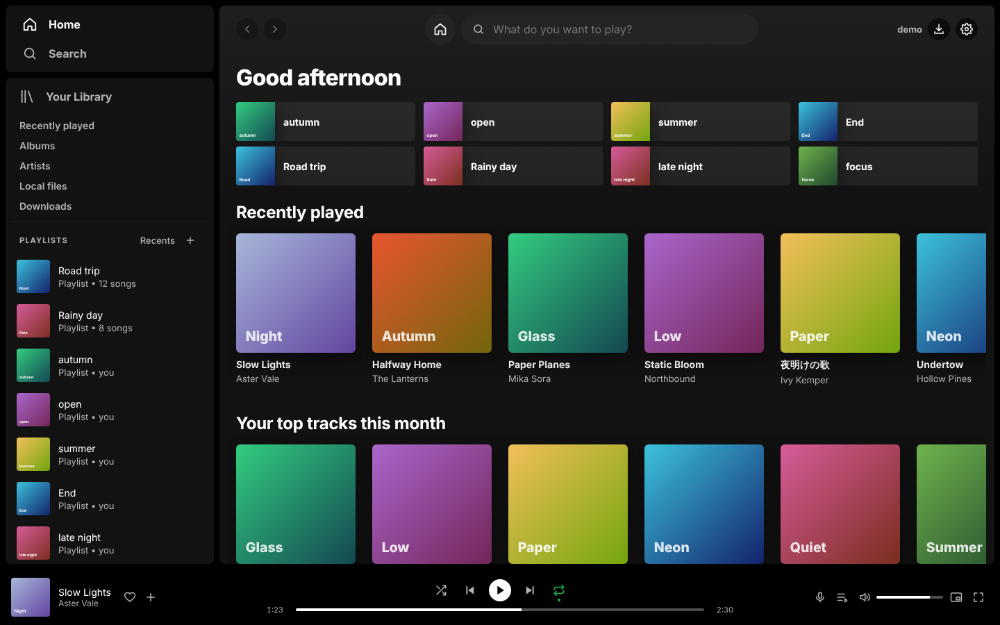

| | |
|---|---|
| 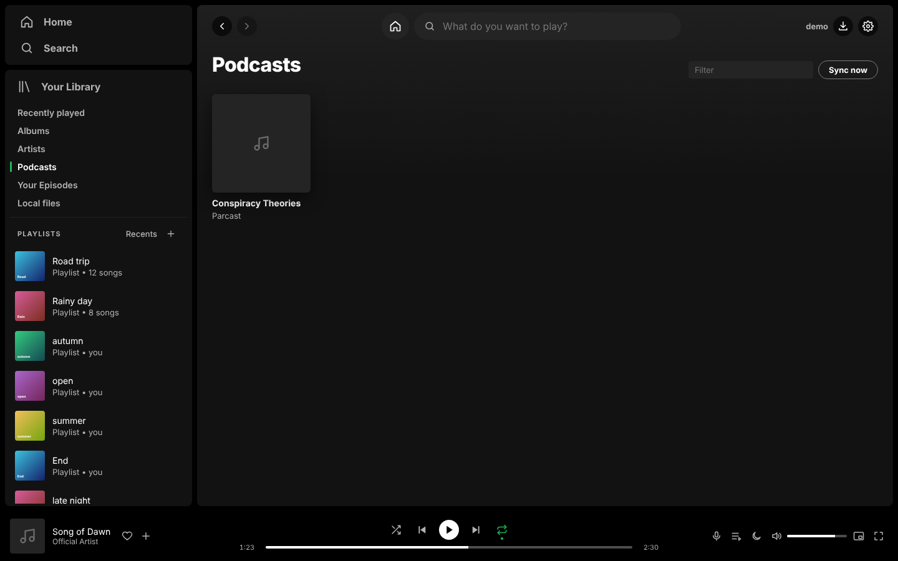 Your Library: classic categories, including podcasts | 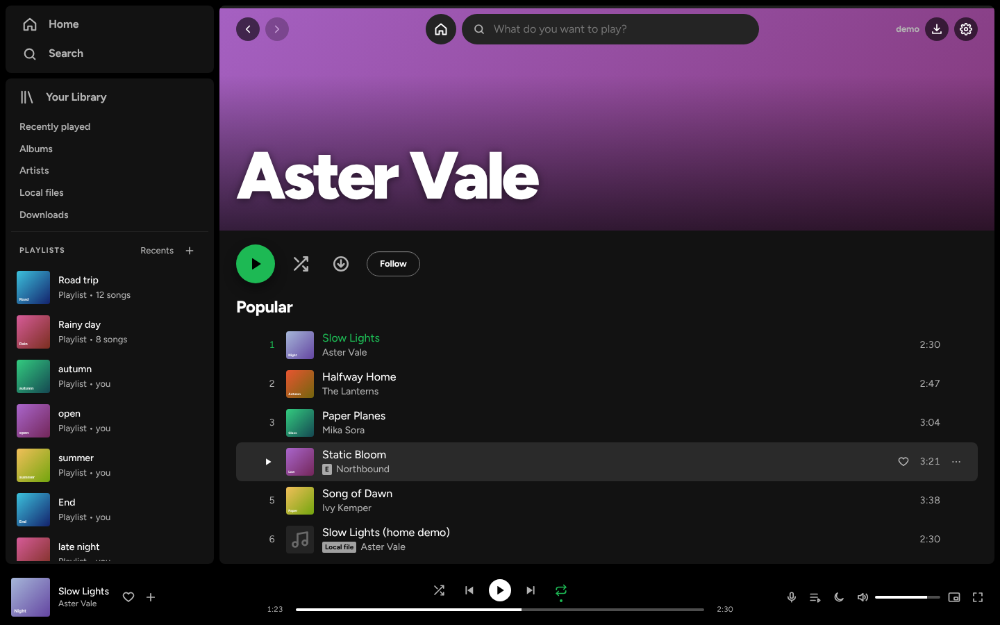 Artist page |
| 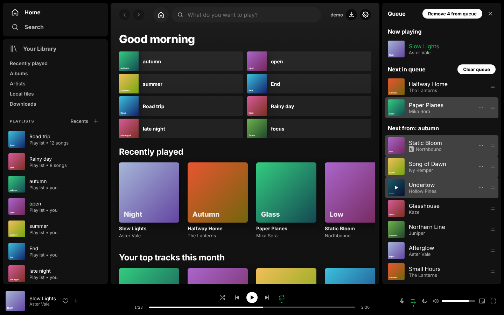 Queue | 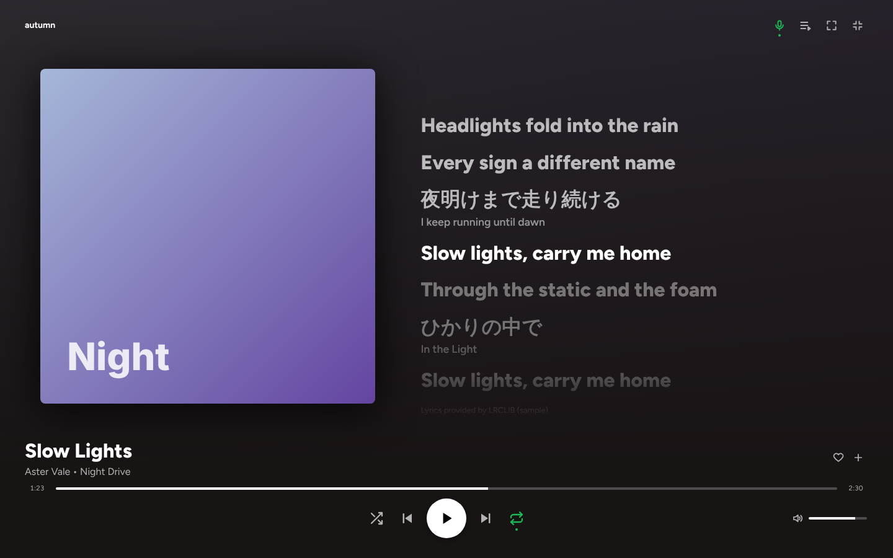 Fullscreen player with synced lyrics |
| 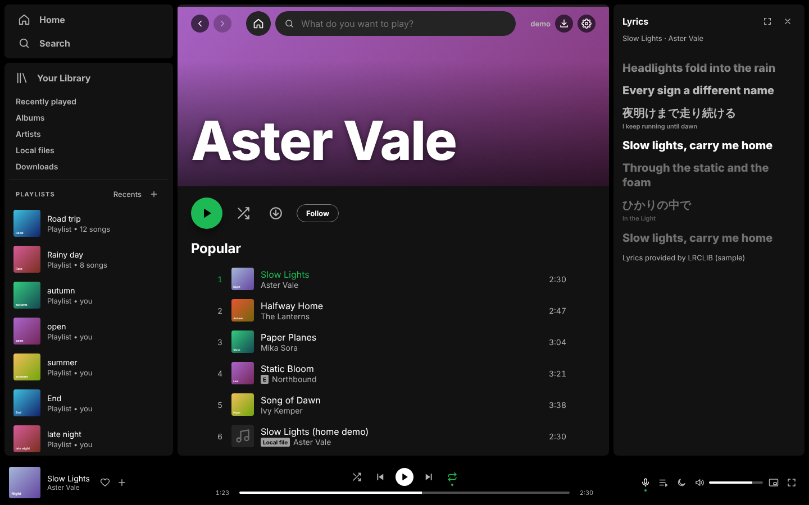 Lyrics in the side panel, translated line by line | 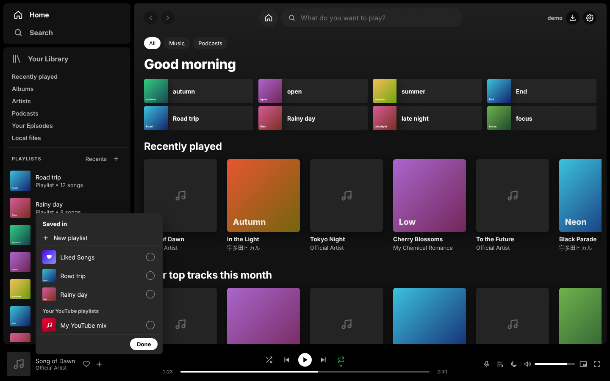 "Saved in": Liked Songs and playlists, including your YouTube playlists |

### Android

| | | | |
|---|---|---|---|
| 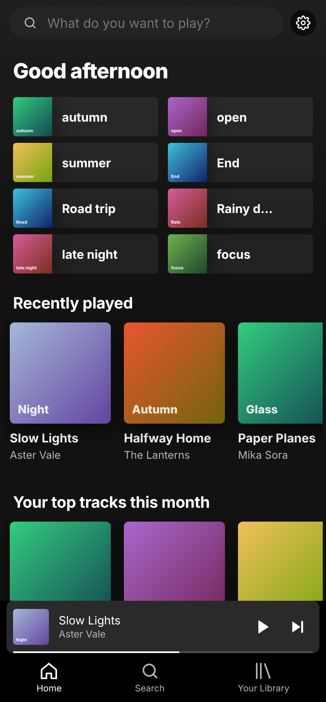 | 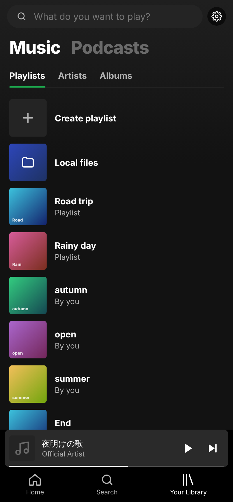 | 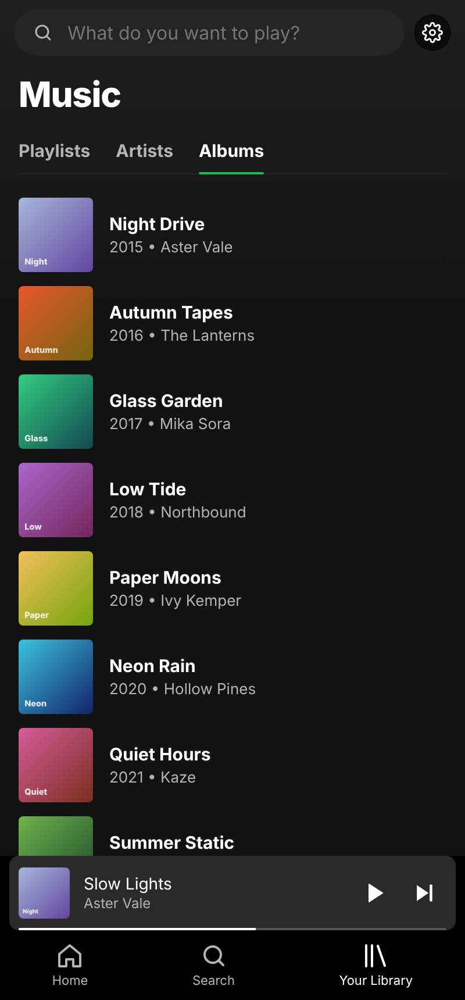 | 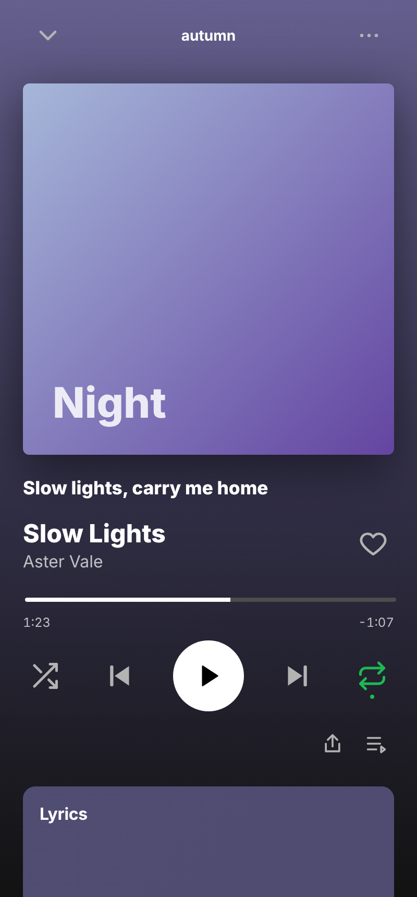 |
| Home | Your Library: Music / Podcasts | Albums | Song screen |

The screenshots use sample data. More are in [docs/screenshots](docs/screenshots/README.md).

## Features

- YouTube Music, Plex and local files in one app, each service with its own on/off switch
- Spotify-style home, combined search (top result, songs, artists, albums, playlists), artist pages and playlists
- Your Library: Recently played, Albums, Artists, Podcasts and Your Episodes (YouTube Music), Local files, Downloads (Plex)
- Crossfade and gapless playback, autoplay of similar songs, and a full queue editor. Crossfade blends songs from the same service.
- Synced lyrics: embedded or from Plex first, then looked up online (LRCLIB, NetEase); no API keys needed
- Lyrics and titles in other scripts, translated into your language (English or Japanese)
- Playlist sorting that sticks, "Saved in" checkboxes for Liked Songs and playlists, and export to text for Soundiiz
- App playlists that mix YouTube Music, Plex and local songs, with custom covers and folders
- Last.fm scrobbling (off by default) and Discord Rich Presence
- TV mode for controllers and remotes, plus a mini player and a tray icon on desktop
- English and Japanese

## Development

See `CLAUDE.md` for commands, `TODO.md` for the backlog and `docs/ARCHITECTURE.md` for the design. Installing, data locations and troubleshooting are in `docs/INSTALL.md`.
