# UI screenshots

Rendered from the production UI build in headless Chromium, with the mock backend in
`ui/e2e/mock-backend.js` standing in for the Rust commands. **The artists, albums, artwork and lyrics
are sample data, not a real Plex or YouTube Music library.**

## Windows (1440×900)

| | |
|---|---|
| 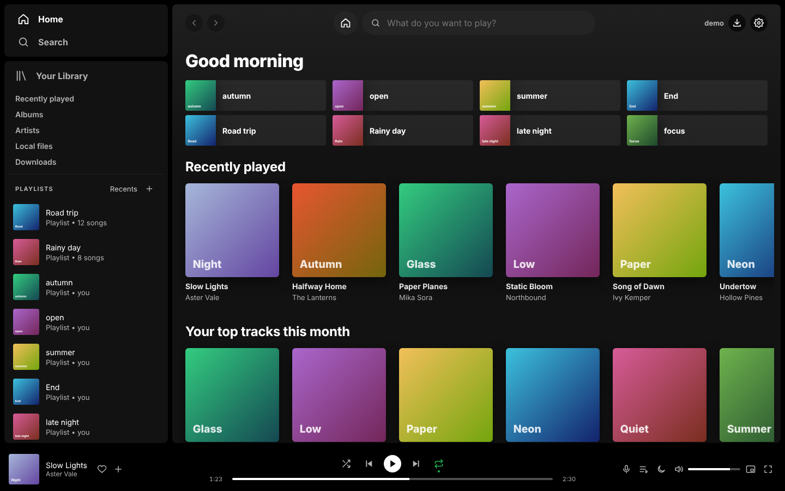 Home: shortcuts, recently played, top tracks | 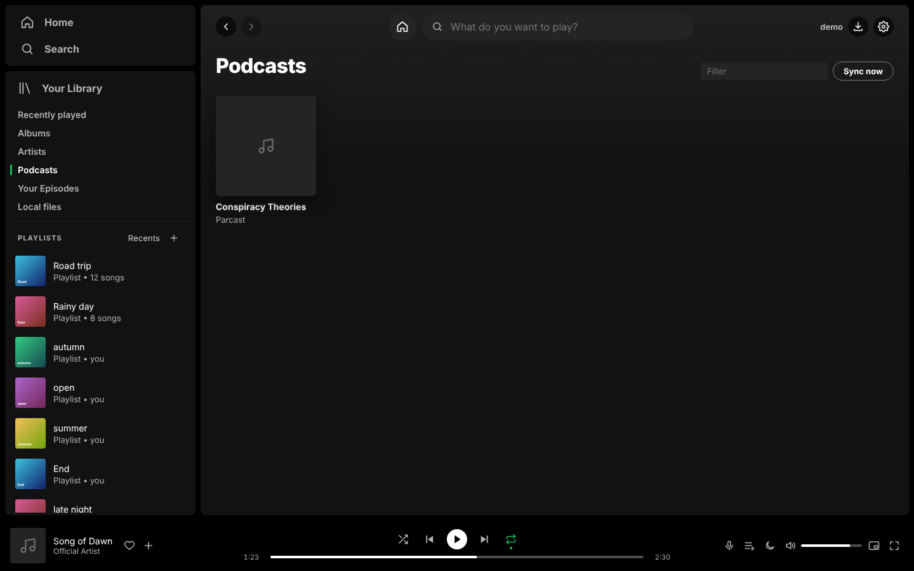 Your Library categories (YTSpot, Podcasts) |
| 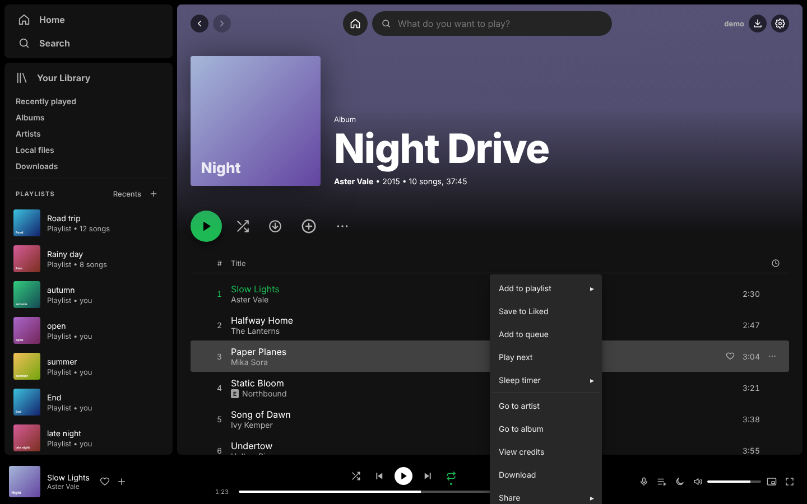 Album page with the track context menu | 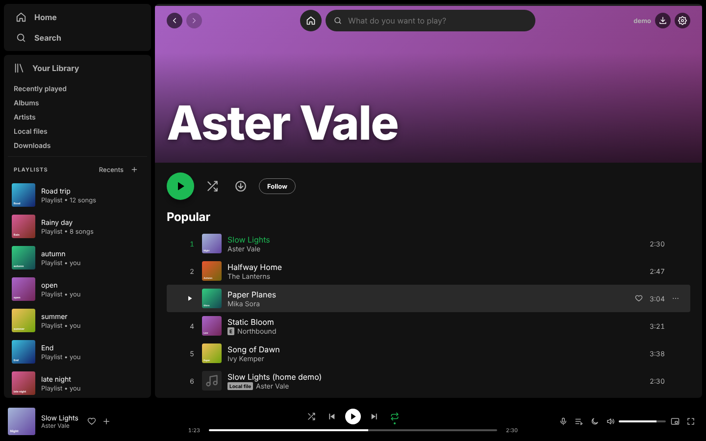 Artist page |
| 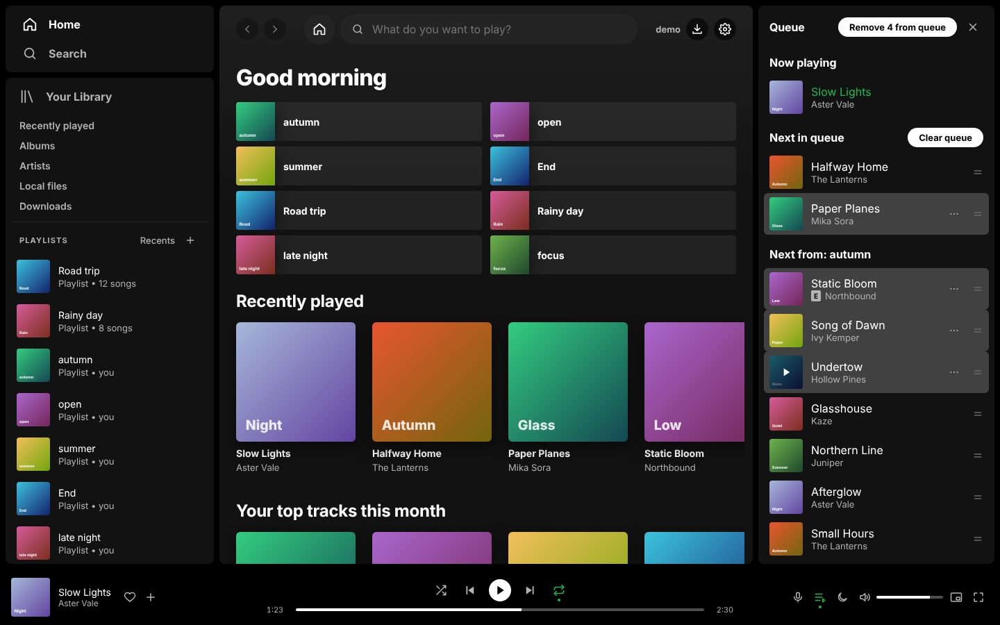 Queue with a Shift-click range selected | 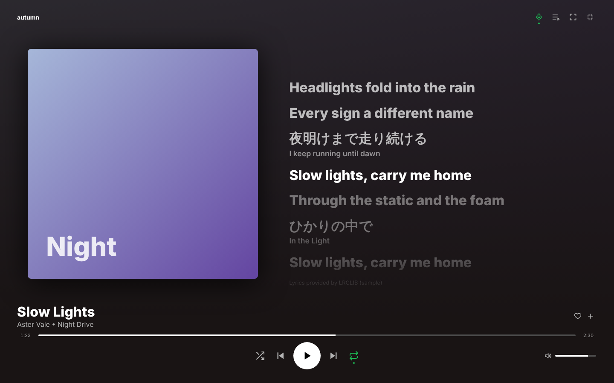 Fullscreen player with synced lyrics |
| 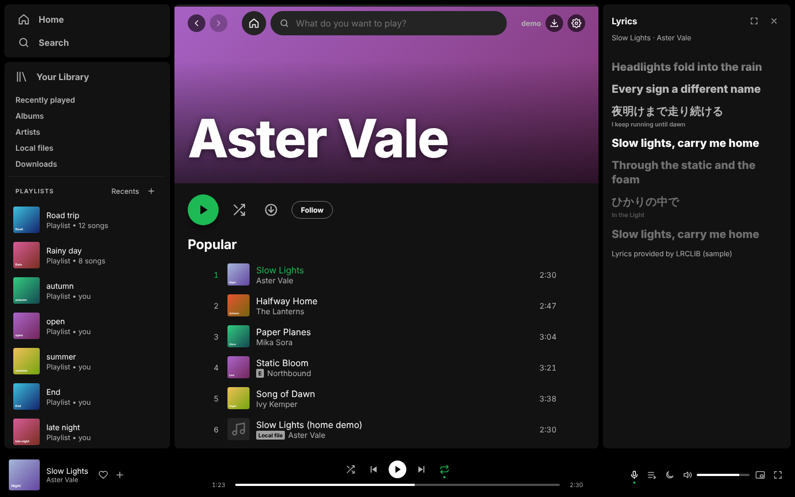 Lyrics side panel with translations | 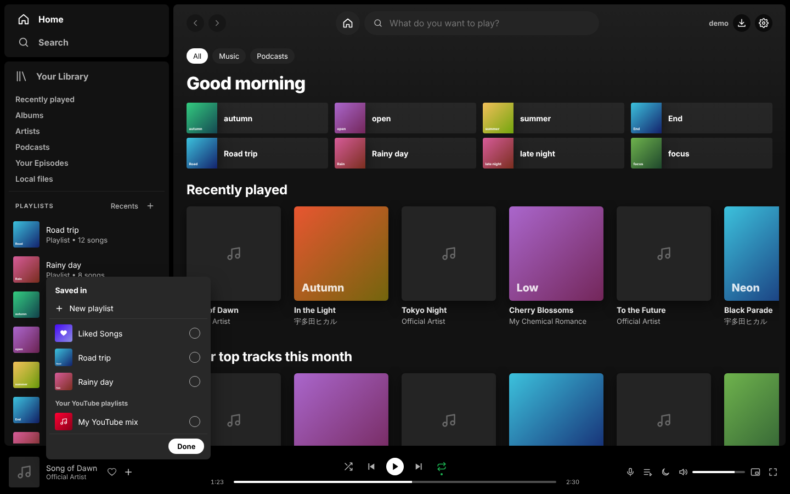 "Saved in" panel (YTSpot) |

## Android (phone)

| | | | |
|---|---|---|---|
| 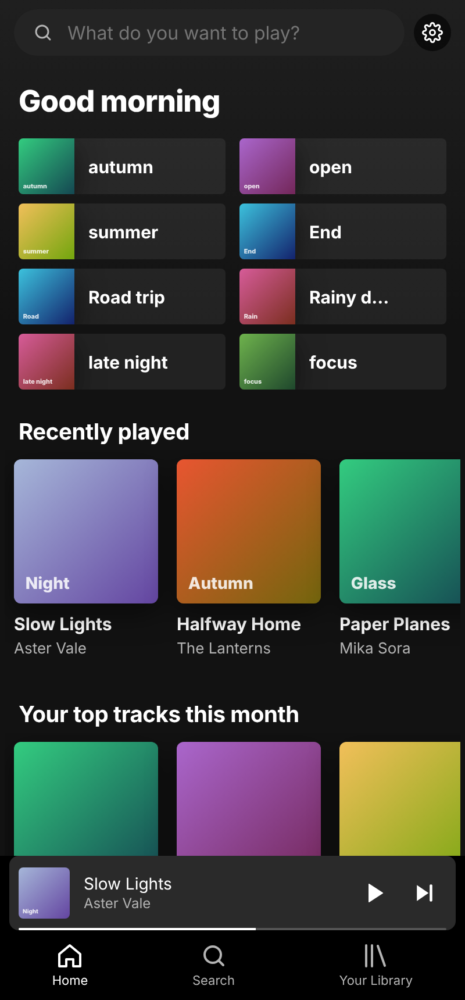 Home | 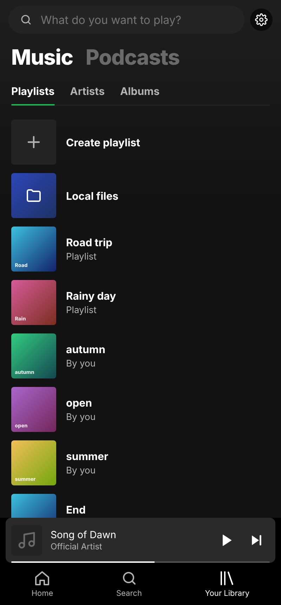 Your Library: Music / Podcasts (YTSpot) | 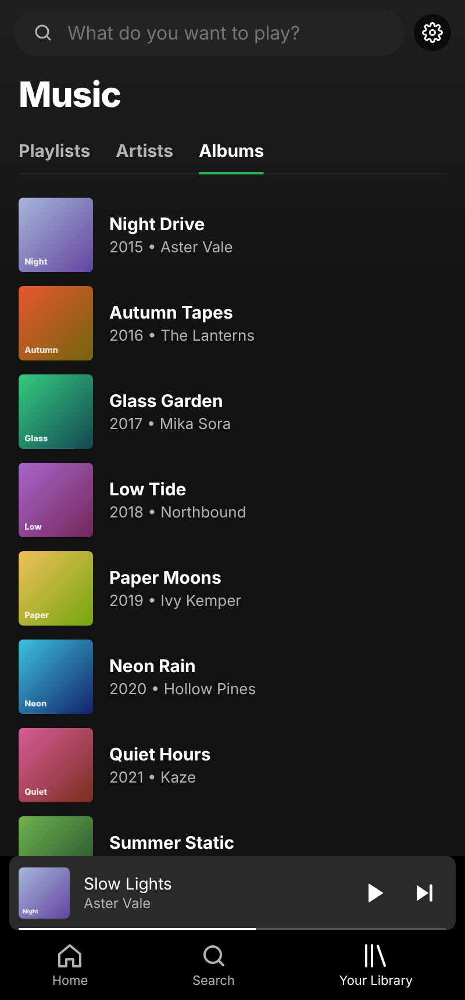 Albums | 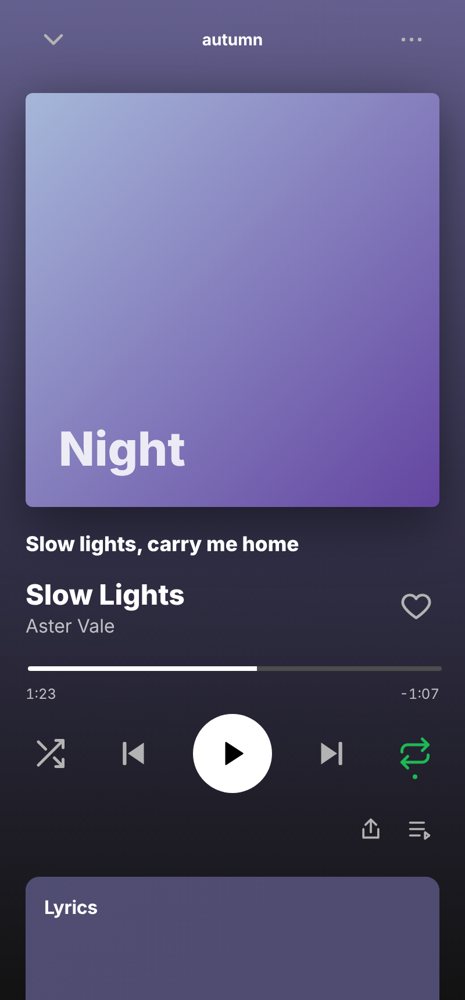 Song screen |

Regenerate: `cd ui && npm run build && node e2e/screenshots.mjs ../docs/screenshots`
(`CHROMIUM=/path/to/chromium` to use a preinstalled browser).
